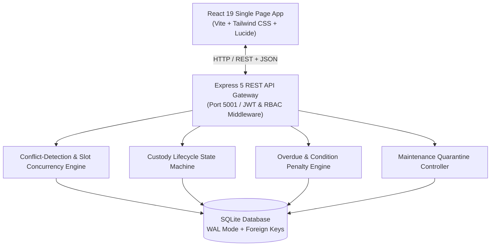
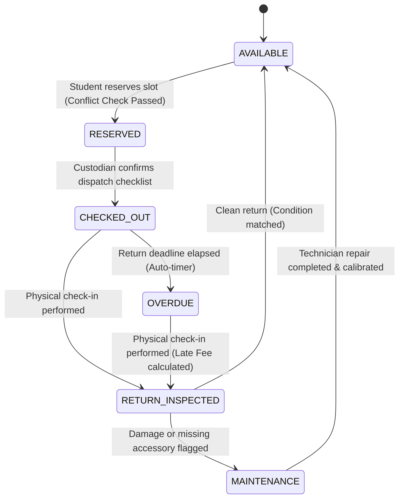

# ⚡ GearFlow — Equipment & Asset Custody Lifecycle Platform

[](https://gearflow-app.onrender.com)
[](https://github.com/dushyanth-mcrps/GearFlow)
[](https://github.com/dushyanth-mcrps/GearFlow)

> 🌐 **Live Deployed Application**: **[https://gearflow-app.onrender.com](https://gearflow-app.onrender.com)**  
> 🔗 **GitHub Repository**: **[https://github.com/dushyanth-mcrps/GearFlow](https://github.com/dushyanth-mcrps/GearFlow)**  
> 💡 *Built with React 19, Node.js / Express 5, MongoDB Atlas (Mongoose) & SQLite (WAL Mode), Tailwind CSS.*

---

## 📌 1. Project Overview

### Problem Statement
In university media laboratories, research maker-spaces, and creative production departments, high-value shared equipment (cinema rigs, oscilloscopes, spatial computing headsets, audio field recorders) frequently suffer from:
1. **Double-Booking & Slot Overlaps**: Traditional spreadsheets lack concurrency control and slot conflict detection.
2. **Untracked Damage & Missing Accessories**: Gear is returned damaged or stripped of cables with zero accountability.
3. **Unenforced Overdue Retention**: Items are hoarded indefinitely without automated penalty mechanisms.
4. **Maintenance Vacuum**: Damaged assets circulate back to students instead of being quarantined and repaired.

### Target Users
- **Borrowers (Students / Faculty / Researchers)**: Browse inventory, verify slot availability in real time, reserve equipment without overlaps, and track custody deadlines.
- **Custodians (Lab Techs / Equipment Vault Staff)**: Perform two-step physical condition verification on dispatch and check-in, assess damage fees, and handle returns.
- **Department Administrators**: Monitor fleet utilization, review immutable custody audit logs, and settle overdue penalty fees.

### Solution
**GearFlow** is an asset lending platform featuring:
- An **atomic conflict-detection reservation engine**
- A **two-step custody verification state machine** (`RESERVED` $\to$ `CHECKED_OUT` $\to$ `IN_USE` $\to$ `RETURN_INSPECTED` $\to$ `RETURNED` / `FLAGGED_DAMAGE`)
- An **automated overdue & damage penalty billing engine**
- An **automatic maintenance quarantine workflow**
- An **immutable append-only audit trail**

---

## 🏗️ 2. Architecture & Technical Design

### System Architecture



### Custody Lifecycle State Machine



---

## 🚀 3. Five Core Engineering Workflows

### 1. Conflict-Free Slot Engine & Reservation Concurrency
- Prevents double-booking by testing temporal intersections:
  $$\text{Overlap} \iff (Start_A < End_B) \land (End_A > Start_B)$$
- Real-time debounced client-side availability probe (`/api/assets/:id/availability`).
- Assets under `MAINTENANCE` lock cannot be scheduled.

### 2. Two-Step Digital Custody Handover
- **Pre-Dispatch Verification**: Serial number check, battery charge check, optics clean, accessories verified.
- **Atomic Custody Transfer**: Transitions reservation to `CHECKED_OUT` and asset to `IN_USE`.

### 3. Automated Overdue & Condition Penalty Engine
- Background sync calculates elapsed hours past deadline:
  $$\text{Overdue Fee} = \lceil \Delta t_{\text{hours}} \rceil \times \text{Hourly Penalty Rate}$$
- Condition grading compares issued state vs returned state.
- Automatic deduction from student deposit balance or billing to account.

### 4. Maintenance Quarantine & Technician Queue
- Flagging damage automatically locks the asset status into `MAINTENANCE`.
- Automatically opens a linked `maintenance_tickets` workorder with severity and repair cost estimate.
- Quarantined gear is removed from catalog reservations until technician repair sign-off.

### 5. Role-Based Portals & Immutable Audit Trail
- Separate views for Student Borrowers and Custodians.
- Non-repudiation audit trail logs timestamp, actor, action, target entity, and inspection notes.

---

## 💻 4. Tech Stack

| Layer | Technologies Used | Key Engineering Decisions |
|---|---|---|
| **Frontend** | React 19, Vite, Tailwind CSS, Lucide Icons | Responsive UI, stateful modaling, live debounced conflict feedback |
| **Backend** | Node.js, Express 5, CORS, Dotenv | Clean layered controller-route-middleware architecture |
| **Database** | SQLite (`better-sqlite3`) | WAL mode enabled, transactional consistency, zero external config for evaluators |
| **Security** | JSON Web Tokens (JWT), bcryptjs | Role-Based Access Control (`borrower`, `custodian`, `admin`) |
| **Testing** | Node.js Test Runner / Custom Harness | 10 end-to-end automated API workflow integration tests |

---

## ⚡ 5. Quick Start & Local Setup

### Prerequisites
- **Node.js**: v18.0.0 or higher
- **npm**: v9.0.0 or higher

### Installation & Run

1. **Clone repository & Install dependencies**:
   ```bash
   git clone https://github.com/dushyanth-mcrps/GearFlow.git
   cd GearFlow
   npm run setup
   ```

2. **Configure Database & Environment**:
   Copy `.env.example` to `server/.env` and paste your MongoDB URI (or leave blank to use the self-contained SQLite WAL engine):
   ```bash
   cp server/.env.example server/.env
   ```

3. **Seed demo inventory and user accounts**:
   ```bash
   # For MongoDB:
   npm run seed:mongo

   # Or for offline SQLite:
   npm run seed
   ```

4. **Verify System Integrity & Automated Tests**:
   ```bash
   npm test
   npm run verify
   ```

5. **Start both backend and frontend concurrently**:
   ```bash
   npm start
   ```

- Frontend runs at: `http://localhost:3000`
- Backend API runs at: `http://localhost:5001`

---

## 🔑 6. Pre-seeded Demo Accounts

Use the **Instant Evaluator Demo Sign-In** button in the UI or enter these credentials:

| Role | Name | Email | Password |
|---|---|---|---|
| **Student Borrower** | Marcus Chen | `student@gearflow.edu` | `Password123!` |
| **Borrower (Robotics)** | Sophia Martinez | `sophia@gearflow.edu` | `Password123!` |
| **Lab Custodian** | Alex Rivers | `custodian@gearflow.edu` | `Password123!` |
| **Department Admin** | Dr. Elena Vance | `admin@gearflow.edu` | `Password123!` |

---

## 🧪 7. Automated Test Suite

GearFlow includes an automated integration test suite covering health checks, auth, conflict detection, checkout, return inspection, penalty calculation, and quarantine:

```bash
npm test
```

Expected output:
```text
🧪 Starting GearFlow Automated Workflow Test Suite...

✅ Test 1: Health check passed
✅ Test 2: Borrower authentication passed
✅ Test 3: Custodian authentication & RBAC passed
✅ Test 4: Asset catalog retrieved (6 items)
✅ Test 5: Conflict detection availability check passed
✅ Test 6: Reservation #5 created successfully
✅ Test 7: Concurrency & double-booking prevention verified
✅ Test 8: Custody handover state transition (CONFIRMED -> CHECKED_OUT) verified
✅ Test 9: Return inspection with damage quarantine ticket #2 verified
✅ Test 10: Operational dashboard stats and audit trail verified

🎉 ALL 10 END-TO-END AUTOMATED TESTS PASSED SUCCESSFULLY!
```

---

## 🔒 8. Security & Error Handling

- **JWT Token Verification**: Expired or forged tokens rejected with `401 Unauthorized`.
- **Role Guard Middleware**: Student borrowers cannot access custodian handover or maintenance endpoints (`403 Forbidden`).
- **Input Sanitization**: DateTime bounds, duration ceiling (max 7 days), and penalty status state validation.
- **Transactional Atomicity**: Database transactions ensure assets are not locked if an error occurs during checkout or return.

---

## 📄 9. Project Submission Checklist

- [x] Functional software application with complete multi-step business logic
- [x] Clear user problem & audience definition
- [x] Five comprehensive core engineering workflows
- [x] Meaningful Git history demonstrating iterative development
- [x] Automated test suite
- [x] Zero-configuration local execution
